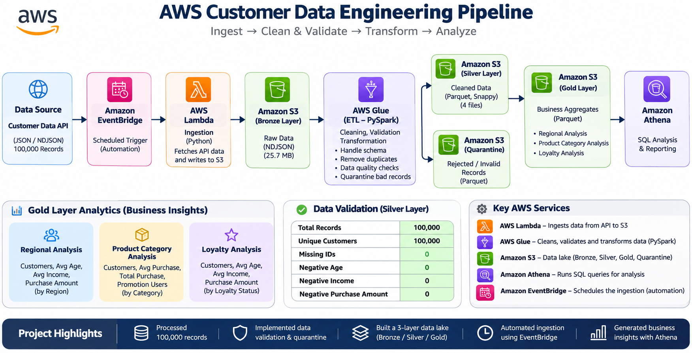

# AWS End-to-End Customer Data Engineering Pipeline

An end-to-end data engineering project built using AWS services to ingest, process, clean, validate, and analyze customer data through a cloud-based data pipeline.

The main goal of this project was to understand how raw data can be transformed into reliable, structured, and analytics-ready data using AWS.

## Project Overview

In this project, I built a customer data pipeline that starts with data ingestion through a REST API and ends with business-level analysis using Amazon Athena.

The pipeline processes a dataset containing **100,000 customer records and 12 columns**. It uses AWS Lambda for ingestion, Amazon S3 for storage, AWS Glue with PySpark for data processing, and Amazon Athena for analytical queries.

I also implemented data quality checks, duplicate identification, record validation, and a quarantine mechanism to separate invalid records from clean data.

## Architecture



The pipeline follows a structured data lake approach:

**REST API → AWS Lambda → Amazon S3 (Bronze) → AWS Glue / PySpark → Amazon S3 (Silver) → Amazon Athena → Gold Analytics**

## Technologies Used

- **Amazon S3** – Data lake storage
- **AWS Lambda** – REST API data ingestion
- **AWS Glue** – ETL processing
- **PySpark** – Data cleaning, transformation, and validation
- **AWS Glue Data Catalog** – Table metadata management
- **AWS Glue Crawler** – Schema discovery
- **Amazon Athena** – SQL-based data analysis
- **Amazon EventBridge** – Scheduling and automation
- **Amazon CloudWatch** – Monitoring
- **Python** – Ingestion and processing logic
- **SQL** – Data validation and business analysis
- **Parquet with Snappy compression** – Optimized storage format

## Pipeline Workflow

### 1. Data Ingestion – Bronze Layer

- Used AWS Lambda to connect to a REST API and retrieve customer data.
- Stored the raw API response in Amazon S3 without modifying the original data.
- Used JSON as the raw storage format.
- Converted the original customer dataset into NDJSON format for record-level processing.

### 2. Data Cleaning and Transformation – Silver Layer

Used AWS Glue with PySpark to process the Bronze data.

The ETL process includes:

- Reading NDJSON data from Amazon S3.
- Handling malformed JSON records.
- Removing unnecessary whitespace and converting blank values to NULL.
- Converting numeric columns into appropriate data types.
- Identifying missing or invalid customer IDs.
- Detecting malformed numeric values.
- Identifying negative values in age, income, and purchase amount.
- Detecting duplicate customer IDs across the dataset.
- Separating invalid records into a dedicated quarantine location.

Clean records are stored in the Silver layer in **Parquet format with Snappy compression**.

### 3. Data Quality and Quarantine

Data quality was an important part of this project.

I implemented validation rules to identify records that do not meet the expected data requirements.

Invalid records are moved to a separate Quarantine location with a reason explaining why they were rejected.

The ETL job also performs record count reconciliation:

`Input Records = Silver Records + Quarantine Records`

This helps verify that records are properly accounted for during processing.

**Validation results from the completed ETL run:**

| Metric | Result |
|---|---:|
| Input records | 100,000 |
| Duplicate ID records | 0 |
| Other invalid records | 0 |
| Silver records | 100,000 |
| Quarantine records | 0 |
| Record reconciliation | Passed |

### 4. Data Analysis – Gold Layer

Created analytics-ready datasets using Amazon Athena and SQL.

Three Gold analytical tables were created:

**Regional Analysis – `customer_data_gold`**

- Customer count by region
- Average customer age
- Average income
- Average purchase amount
- Total purchase amount

**Product Category Analysis – `gold_product_category_analysis`**

- Customer count by product category
- Average purchase amount
- Total purchase amount
- Number of customers using promotions

**Loyalty Analysis – `gold_loyalty_analysis`**

- Customer count by loyalty status
- Average age
- Average income
- Average purchase amount
- Total purchase amount

The Gold datasets were stored in Amazon S3 in Parquet format and queried using Athena.

### 5. Automation and Monitoring

The project also includes automation and monitoring configurations to support pipeline execution and operational visibility.

- Configured automation for pipeline execution.
- Implemented monitoring for pipeline operations.
- Used AWS services to help identify execution issues and failures.

## Repository Structure

```text
aws-customer-data-engineering-pipeline/
│
├── architecture/
│   └── architecture.png
│
├── scripts/
│   ├── lambda_ingestion.py
│   └── bronze_to_silver.py
│
├── sql/
│   ├── silver_validation.sql
│   ├── gold_regional.sql
│   ├── gold_product_category.sql
│   ├── gold_loyalty.sql
│   └── gold_validation.sql
│
├── screenshots/
│   ├── bronze/
│   ├── silver/
│   ├── glue/
│   ├── quarantine/
│   └── athena/
│
└── README.md
```

## Key Outcomes

- Processed a dataset containing 100,000 customer records.
- Built an AWS-based ingestion and ETL pipeline.
- Implemented PySpark-based data cleaning and validation.
- Identified duplicate IDs and invalid records.
- Created a separate quarantine process for rejected records.
- Stored processed data in compressed Parquet format.
- Built three analytical Gold datasets.
- Verified that the Gold product category and loyalty customer counts each reconcile to 100,000 records.
- Used Amazon Athena to perform SQL-based analysis.

## What I Learned

Working on this project gave me practical experience with AWS data engineering services and helped me understand how different cloud services work together in a data pipeline.

I gained hands-on experience with REST API ingestion, S3 data lake organization, AWS Glue, PySpark transformations, data quality validation, Parquet storage, Athena SQL queries, and pipeline monitoring.

It also helped me understand the importance of data reliability, record reconciliation, and separating raw, processed, and analytics-ready data.

## Screenshots

Screenshots of the AWS implementation and query results are available in the `screenshots/` directory.

They cover the S3 Bronze layer, Glue ETL processing, Silver layer, Quarantine location, and Athena analytical results.

## Author

**Aman Nazare**

M.Sc. Data Science

GitHub: [@Amannazare](https://github.com/Amannazare)

---

*This project was developed as a hands-on learning project to gain practical experience in AWS Data Engineering and cloud-based data processing.*
